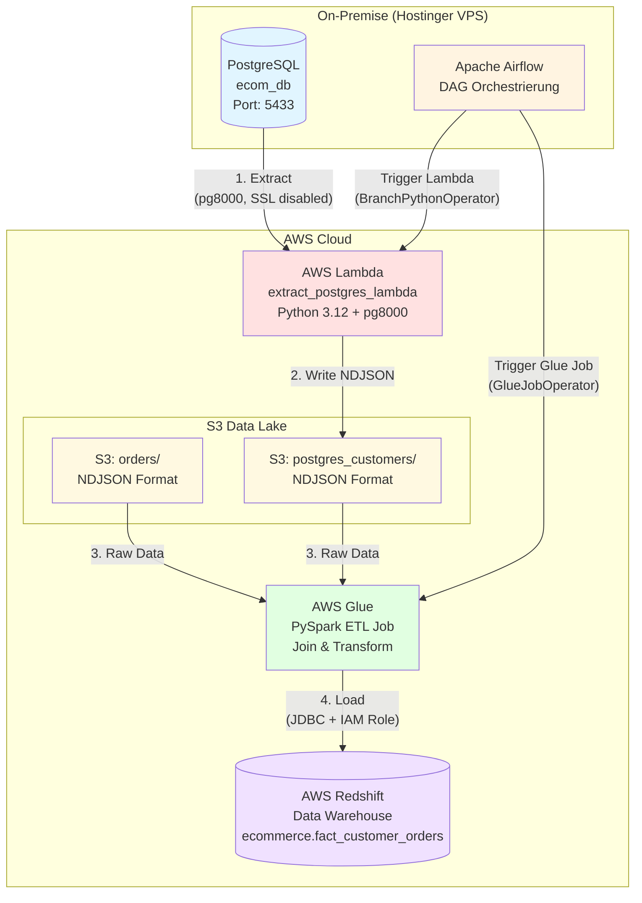

# E-Commerce Multi-Source Data Pipeline

## Einführung

In modernen E-Commerce-Unternehmen fallen täglich große Mengen an Transaktionsdaten aus verschiedenen Quellen an: Webshop-Bestellungen, Kundenstammdaten aus ERP-Systemen, Klickstreams aus Marketing-Plattformen und mehr. Die Herausforderung besteht darin, diese heterogenen Datenquellen in ein zentrales Data Warehouse zu integrieren, um fundierte Geschäftsentscheidungen zu ermöglichen.

Dieses Projekt implementiert eine **produktionsreife, Cloud-native Data Pipeline**, die Kundendaten aus einer On-Premise PostgreSQL-Datenbank und Bestelldaten aus AWS S3 in ein AWS Redshift Data Warehouse lädt. Die Pipeline wird durch Apache Airflow orchestriert und nutzt AWS Lambda für die serverlose Datenextraktion sowie AWS Glue (PySpark) für die Transformation. Ein besonderer Fokus liegt auf der Implementierung von **intelligentem Branching** (Full vs. Incremental Load), um Ressourcen effizient zu nutzen und Cloud-Kosten zu optimieren – eine Fähigkeit, die in der Praxis entscheidend ist.

Das Projekt demonstriert nicht nur technische Implementierung, sondern auch **Best Practices im Data Engineering**: Idempotente Skripte, Data Quality Constraints an der Quelle, Least-Privilege-Zugriffskonzepte und saubere Trennung von Metadaten (Airflow) und Geschäftsdaten (PostgreSQL).

## Tech Stack

- **Orchestrierung:** Apache Airflow (DAG mit 8 Tasks & dynamischem Branching)
- **ETL / Verarbeitung:** AWS Glue (PySpark)
- **Data Sources:** 
  - AWS S3 (JSON - Webshop Events/Orders)
  - PostgreSQL (Kundenstammdaten)
- **Micro-ETL / Trigger:** AWS Lambda (Extraktion Postgres -> S3)
- **Data Sink:** AWS Redshift (Data Warehouse)
- **Infrastructure:** Hostinger VPS (Airflow), AWS Cloud

##  Architektur 

##  Der Airflow DAG (8 Tasks, 2 Branches)

Der DAG `ecommerce_data_pipeline` implementiert ein intelligentes Routing basierend auf dem Datenvolumen:

1. `start_pipeline` (Dummy)
2. `check_data_volume` (PythonOperator - Prüft erwartetes Datenaufkommen)
3. `branch_decision` (BranchPythonOperator - Entscheidet über Routing)
   - **Branch A:** `branch_full_load` (Lambda Trigger für kompletten Postgres Export)
   - **Branch B:** `branch_incremental_load` (Lambda Trigger für Daily Delta)
4. `join_branches` (Dummy - Synchronisiert die Pfade)
5. `run_glue_etl` (GlueJobOperator - Führt PySpark Join & Transformation aus)
6. `validate_redshift_data` (PythonOperator - Data Quality Check)

